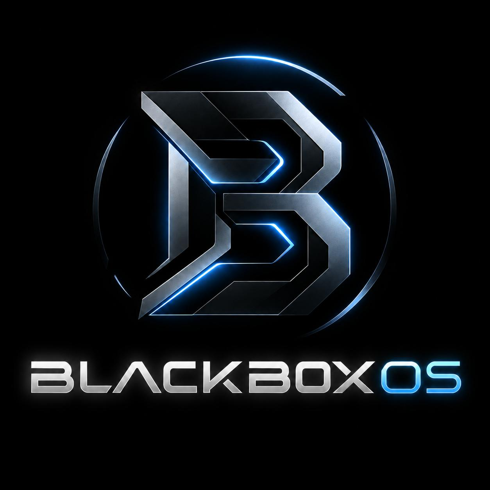

<p align="center">
  
</p>

# BlackBoxOS

### A Lightweight, Performance-Driven 64-Bit Operating System Built with C and Rust

**BlackBoxOS** is an independent operating system development project focused on building a lightweight, efficient, secure, and extensible computing platform from the ground up.

The project aims to combine low-level hardware control, efficient resource management, a minimal desktop environment, and a unified application ecosystem. Its central design principle is to deliver essential operating system functionality with minimal unnecessary storage, memory, and CPU overhead.

BlackBoxOS is being designed for compatible 64-bit x86 systems, including older processors and modern hardware.

> **Project status:** Early development. The repository and development toolchain are being established. Kernel, driver, filesystem, desktop, and compatibility features are planned for incremental implementation and verification.

---

## 01. Vision and Objectives

The objective is to develop a general-purpose operating system that prioritizes efficiency without sacrificing correctness, security, or maintainability.

### Core objectives

- **Minimal footprint:** Keep the base installation compact and separate optional components from essential system functionality.
- **Efficient resource utilization:** Minimize idle CPU usage, unnecessary memory allocation, and background activity.
- **Responsive execution:** Optimize process creation, executable loading, scheduling, and application startup.
- **Modern systems engineering:** Combine C's low-level control with Rust's memory safety features where appropriate.
- **Hardware compatibility:** Target a documented baseline of 64-bit x86 processors and expand hardware support incrementally.
- **Modular architecture:** Maintain clear boundaries between the kernel, drivers, system services, and applications.
- **Application ecosystem:** Develop native applications first, followed by selected Linux and Windows compatibility capabilities.
- **Security by design:** Implement privilege separation, memory protection, process isolation, and controlled access to system resources.
- **Measurable performance:** Evaluate design decisions using repeatable benchmarks rather than unsupported performance claims.

## 02. What Makes BlackBoxOS Different?

BlackBoxOS is designed around a performance-first philosophy.

| Design principle | Engineering approach |
|---|---|
| Minimal by default | Essential components form the base installation; optional functionality is installed separately |
| Resource-aware | Scheduling, memory allocation, caching, and background activity are measured and optimized |
| Mixed-language kernel | C and Rust are assigned clear responsibilities with explicit interfaces |
| Native-first applications | Lightweight native applications avoid unnecessary compatibility overhead |
| Optional compatibility | Linux and Windows compatibility environments are introduced independently |
| Incremental hardware support | Drivers are developed and tested against documented hardware targets |
| Benchmark-driven optimization | Changes are evaluated against reproducible baselines |
| Security-conscious design | Isolation and permission boundaries are established before broad application support |

The objective is not simply to create a smaller kernel. Overall efficiency depends on the kernel, drivers, system libraries, desktop, applications, and compatibility runtimes working together.

## 03. Technology Stack

| Technology | Purpose |
|---|---|
| C | Low-level kernel development, hardware interfaces, and performance-critical components |
| Rust | Memory-safe abstractions, selected kernel subsystems, system services, and native utilities |
| NASM | Architecture-specific assembly where required |
| x86-64 | Primary processor architecture |
| UEFI | Initial modern firmware boot path |
| GCC / Clang | C compilation and freestanding code generation |
| Rust toolchain | Rust compilation and dependency management |
| GNU Make | Build orchestration |
| Cargo | Rust project and build management |
| ELF64 | Planned native executable format |
| QEMU | Virtual machine execution and system testing |
| GDB | Kernel debugging and execution inspection |
| GRUB | Candidate bootloader for the initial implementation |
| Git | Version control and development history |
| GitHub | Source hosting, documentation, and project collaboration |

Tool selection may evolve as implementation requirements become clearer. Kernel builds will use appropriate freestanding configurations rather than relying on ordinary host application settings.

## 04. System Architecture

BlackBoxOS is planned as a modular monolithic operating system.

This architecture provides a practical balance between direct kernel subsystem communication, performance, and maintainability.

```text
┌──────────────────────────────────────────────┐
│              BLACKBOX DESKTOP                │
│   Launcher · Windows · Terminal · Utilities  │
├──────────────────────────────────────────────┤
│              USER SPACE                      │
│   Native Applications · Libraries · Services │
├──────────────────────────────────────────────┤
│          APPLICATION INTERFACE               │
│   System Calls · IPC · Executable Loading    │
├──────────────────────────────────────────────┤
│               KERNEL                         │
│  Processes · Scheduler · Virtual Memory      │
│  Filesystems · Security · Timers · IPC       │
├──────────────────────────────────────────────┤
│          DEVICE AND I/O SUBSYSTEMS           │
│   Storage · Input · Display · Networking     │
├──────────────────────────────────────────────┤
│          ARCHITECTURE AND BOOT               │
│       UEFI · CPU Initialization · x86-64     │
├──────────────────────────────────────────────┤
│                  HARDWARE                    │
│             CPU · RAM · Devices              │
└──────────────────────────────────────────────┘
```

*Conceptual target architecture. Components will be implemented progressively.*

### Kernel responsibilities

- CPU initialization, interrupts, and exception handling
- Physical and virtual memory management
- Process and thread lifecycle management
- CPU scheduling and synchronization
- System calls and user-mode transitions
- Device management and hardware interfaces
- Filesystem and storage interfaces
- Inter-process communication
- Resource accounting and diagnostics

### User-space responsibilities

Applications, the graphical desktop, suitable system services, package management, and compatibility runtimes will run outside the kernel wherever practical.

This separation reduces the amount of code requiring kernel privileges and makes individual components easier to maintain.

## 05. C and Rust Engineering Strategy

BlackBoxOS will use both languages deliberately rather than duplicating the same subsystems.

### C

C will be used where direct hardware access, established compiler support, and low-level control are important.

Planned areas include architecture initialization, selected memory management primitives, hardware interfaces, and C-compatible subsystem boundaries.

### Rust

Rust will be used where ownership, type safety, and explicit error handling can reduce implementation risks.

Planned areas include safe subsystem abstractions, synchronization interfaces, selected filesystem and networking components, and system utilities.

Kernel Rust code will use `no_std` where necessary.

### Language interoperability

The project will define explicit interfaces between C and Rust, including calling conventions, memory ownership, error handling, and pointer safety.

Unsafe Rust will be limited and documented. C code will be written to avoid undefined behavior and invalid memory access.

## 06. Planned Operating System Capabilities

The following capabilities represent the development roadmap, not a claim that they are already implemented.

| Subsystem | Planned functionality |
|---|---|
| Process management | Process creation, termination, identifiers, and isolation |
| CPU management | Threads, scheduling, synchronization, and context switching |
| Memory management | Physical allocation, virtual memory, paging, and heap management |
| File management | Files, directories, metadata, and file operations |
| Storage management | Block devices, partitions, free space, and persistent storage |
| Device management | Hardware discovery and driver interfaces |
| I/O management | Keyboard, mouse, display, and storage operations |
| Security | Privilege separation, memory protection, and permissions |
| Networking | Ethernet, IP, TCP, UDP, DNS, and socket interfaces |
| User management | Accounts, authentication, and administrative privileges |
| User interface | Terminal, graphical desktop, and application launcher |
| System calls | Controlled user-to-kernel interfaces |
| Error handling | Exception reporting, kernel diagnostics, and fault handling |
| Resource management | CPU, RAM, storage, and device allocation |
| Boot management | Firmware boot, kernel loading, and initialization |
| Power management | Shutdown, reboot, idle states, and future sleep support |
| Virtualization | Optional virtual machine support |
| Time management | Timers, monotonic clock, and real-time clock integration |
| IPC | Pipes, shared memory, and synchronization primitives |
| Logging and monitoring | Kernel logs, system logs, and resource diagnostics |

## 07. Unified Application Ecosystem

A long-term objective is to provide a unified application interface for native BlackBoxOS programs and selected applications from other operating systems.

### Native applications

BlackBoxOS will prioritize native ELF64 applications using a documented application interface and a lightweight package manager.

### Linux applications

Planned compatibility work includes Linux executable loading, selected Linux system calls, library compatibility, and package management.

Potential package formats include:

- Debian packages (`.deb`)
- RPM packages (`.rpm`)
- AppImage
- Flatpak

Package extraction and application execution are separate capabilities. Actual support will depend on the required runtime, system interfaces, libraries, and dependencies.

### Windows applications

Windows compatibility is a separate long-term engineering objective.

The project may investigate established compatibility approaches such as Wine and implement support for selected Windows executables and APIs.

Recognizing an `.exe` or `.msi` file does not guarantee that its application will run.

### Virtual machines

Optional virtualization may be used for applications that cannot be supported efficiently through compatibility layers.

Virtual machines will remain optional because they introduce additional storage, memory, and CPU overhead.

## 08. Performance Engineering

Performance will be treated as a measurable engineering requirement.

### CPU efficiency

- Avoid unnecessary background services.
- Minimize busy waiting.
- Use appropriate interrupt-driven operations.
- Optimize scheduling and context switching.
- Reduce unnecessary timer wakeups.
- Profile performance before applying targeted optimizations.

### Memory efficiency

- Implement efficient physical and virtual memory allocation.
- Reduce unnecessary copies and allocations.
- Support demand paging and shared libraries when the required infrastructure is ready.
- Reclaim caches under memory pressure.
- Preserve process isolation and memory protection.

### Storage efficiency

- Keep the base installation small.
- Separate optional drivers, runtimes, and applications.
- Avoid redundant libraries and dependencies.
- Use suitable caching and buffering strategies.
- Measure installed size and runtime disk activity.

### Desktop responsiveness

- Minimize unnecessary redraws and animations.
- Keep UI operations responsive during disk and network activity.
- Reduce application startup dependencies.
- Prefer lightweight native applications for low-resource environments.

### Benchmarking policy

Performance comparisons will record the hardware, software configuration, test method, and measurement conditions.

Planned measurements include boot time, idle RAM, idle CPU utilization, application launch time, memory allocation latency, context-switch overhead, storage throughput, and UI responsiveness.

BlackBoxOS will not claim to outperform established operating systems without reproducible evidence.

## 09. Target Hardware

The primary target is compatible 64-bit x86 hardware.

The project aims to support older 64-bit Intel Pentium processors as well as modern x86-64 CPUs.

Compatibility requirements will be documented explicitly.

- Establish a minimum supported instruction set.
- Avoid requiring unnecessary modern CPU extensions.
- Detect required CPU capabilities before using optional instructions.
- Test in QEMU with constrained CPU and memory configurations.
- Validate hardware support on physical systems.
- Treat Wi-Fi, USB, advanced graphics, and power management as separate driver and integration challenges.

A 64-bit CPU alone does not guarantee compatibility with every required instruction, firmware feature, or peripheral.

## 10. Development Roadmap

Development will proceed through verified milestones.

- [ ] **Phase 01 — Foundation:** Repository structure, toolchain, boot configuration, and build system.
- [ ] **Phase 02 — Bootable kernel:** UEFI boot, kernel entry, welcome message, and serial diagnostics.
- [ ] **Phase 03 — CPU infrastructure:** Descriptor tables, interrupts, exceptions, and timers.
- [ ] **Phase 04 — Memory management:** Physical allocation, paging, virtual memory, and kernel heap.
- [ ] **Phase 05 — Multitasking:** Kernel threads, context switching, and scheduling.
- [ ] **Phase 06 — User mode:** Process isolation, system calls, and ELF64 loading.
- [ ] **Phase 07 — Terminal:** Shell, command execution, and native utilities.
- [ ] **Phase 08 — Storage:** Block devices, filesystem interfaces, and persistent file operations.
- [ ] **Phase 09 — Device support:** Keyboard, mouse, display, and additional hardware.
- [ ] **Phase 10 — Security:** Permissions, accounts, IPC, and isolation.
- [ ] **Phase 11 — Networking:** Network devices, protocols, and sockets.
- [ ] **Phase 12 — Desktop:** Window manager, launcher, file manager, and native applications.
- [ ] **Phase 13 — System services:** Logging, monitoring, shutdown, and power management.
- [ ] **Phase 14 — Linux compatibility:** Selected Linux APIs and package support.
- [ ] **Phase 15 — Windows compatibility:** Research and implementation of selected Windows APIs.
- [ ] **Phase 16 — Advanced features:** Virtualization, additional hardware support, and compatibility improvements.
- [ ] **Phase 17 — Optimization:** Benchmarking, reliability testing, security hardening, and release engineering.

Each milestone must be built, tested, and documented before the project depends on it.

## 11. Repository Structure

The initial source layout is organized by responsibility.

```text
BlackBoxOS/
├── boot/                 # Bootloader and boot configuration
├── kernel/
│   ├── c/                # C kernel implementation
│   └── rust/             # Rust kernel components
├── include/              # C headers and shared interfaces
├── scripts/              # Build and development scripts
├── build/                # Generated build artifacts
├── docs/                 # Architecture and technical documentation
├── .gitignore            # Excluded generated files
└── README.md             # Project documentation
```

The structure will evolve as actual implementations and subsystem boundaries are established.

Generated files should remain separate from source code. Build artifacts will generally not be committed to Git.

## 12. Build and Development Environment

The current development environment is Ubuntu Linux.

The toolchain includes GCC, Clang, LLVM LLD, Rust, Cargo, NASM, GNU Make, QEMU, GDB, and Git.

The initial development workflow is

1. Write or modify source code.
2. Compile the relevant C and Rust components.
3. Link the kernel and generate the boot image.
4. Start the image in QEMU.
5. Inspect serial output and debug failures.
6. Run milestone-specific tests.
7. Commit verified source changes.

Exact build commands and supported configurations will be documented when the initial bootable implementation is established.

## 13. Quality and Security Principles

BlackBoxOS follows these engineering principles.

- Reproducible builds and documented toolchains.
- Clear interfaces and modular implementation.
- Explicit error handling.
- Minimal privileged code.
- Safe memory management and process isolation.
- Automated tests where practical.
- Repeatable performance measurements.
- No unsupported claims about functionality or compatibility.
- No unverified code marked as tested.
- Safe development through virtual machines and disk images.

The initial development environment must not modify the host computer's boot configuration or physical disks without explicit authorization.

## 14. Current Development Status

**Current stage: Initial project setup.**

The repository structure and development toolchain are being prepared.

The next milestone is to implement and verify a minimal bootable x86-64 kernel using C and Rust, with UEFI boot support, serial diagnostics, and QEMU testing.

Advanced functionality, including multitasking, persistent storage, graphical desktop support, networking, and application compatibility, remains planned until implemented and tested.

## 15. Project Philosophy

BlackBoxOS is an exploration of how a general-purpose operating system can be designed around efficiency, clarity, and control.

The objective is not to reproduce every feature of existing operating systems immediately. It is to establish a reliable foundation, understand each subsystem, measure its behavior, and expand the system through deliberate engineering.

**Build small. Measure everything. Optimize intelligently. Expand progressively.**

---

## License

A project license has not yet been selected. Licensing terms will be added before the project is distributed as an open-source release.

---

**BlackBoxOS**  
*Independent operating system engineering · C · Rust · x86-64*
